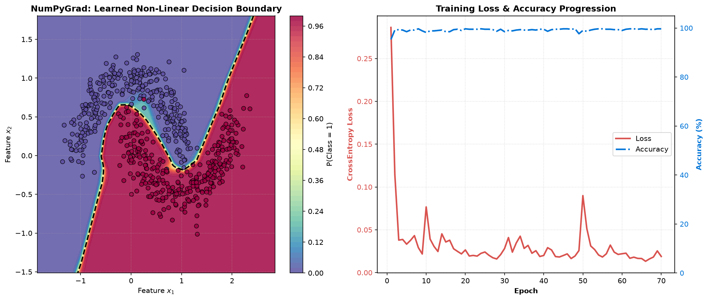

# NumPyGrad: Pure NumPy Autograd & Deep Learning Framework

[](https://www.python.org/downloads/)
[](#)
[](https://github.com/Htet-Aung/numpygrad/actions/workflows/tests.yml)
[](LICENSE)

**NumPyGrad** is a deep learning and reverse-mode automatic differentiation framework built from scratch with Python and NumPy. I built it as an Applied AI and Data Analytics side project to understand gradient computation, model training, and evaluation by implementing each part myself. The optional Streamlit studio turns those ideas into interactive experiments.

**Try the studio locally:** From the repository root, run `pip install -e ".[app]"` then `streamlit run app/app.py`. The MNIST drawing demo loads a committed model; the 2D and rover views train small models in your session. See [deployment steps](docs/DEPLOYMENT.md) if you want to host it.

**Live demo:** Coming soon. This link will be added after deployment.

**Measured result:** A reproducible [known-wall study](docs/NAVIGATION_STUDY.md) trained 60 classifiers across ten seeds, two widths, and three training-noise levels, then evaluated 120 rover routes against the true obstacle map. Wider models improved mean held-out accuracy, but accuracy alone did not guarantee a safe route. The [per-run data](docs/results/navigation_study.csv) and [plot](docs/results/navigation_study.png) are included. The study uses a separate known-wall map, not the studio's corridor preset.

The committed MNIST examples reached **97.16% test accuracy with an MLP** and **98.04% with a CNN** on the 10,000-image test set, using validation-selected checkpoints. These are single-seed results; the training details are [below](#reproducing-examples--benchmarks).


The project demonstrates dynamic graph construction, analytical backpropagation, gradient checking, model serialization, validation-based checkpoint selection, and measured downstream behavior. The core library does not use PyTorch, TensorFlow, JAX, or another automatic differentiation framework.

The Streamlit Studio has three interactive views:
1. **2D Decision Boundary Explorer:** Train on synthetic datasets, inspect held-out results and validation mistakes, compare model capacities, and test coordinates on the learned boundary.
2. **Autonomous Neural Pathfinding:** Drive a rover using a learned obstacle-risk map and compare navigation outcomes across models. The accompanying known-wall study measures how classification quality relates to route success.
3. **Handwritten Digit Recognition:** Draw one or more digits, inspect the segmented inputs, and view the model's softmax scores. These scores are not calibrated probabilities.

---

## Visual Showcase: Non-Linear Decision Boundary

NumPyGrad trains multi-layer perceptrons to resolve complex non-linear classification manifolds through topological reverse-mode backpropagation and AdamW optimization:

<p align="center">
  
</p>

---

## Comprehensive Feature Breakdown

### 1. Autograd Core & Calculus Engine
- **Dynamic Reverse-Mode DAG:** Constructs computation graphs on the fly where each differentiable operation dynamically tracks predecessor nodes (`_prev`) and local Jacobian-vector product closures (`_backward`).
- **Topological Backpropagation:** Evaluates gradients via depth-first topological traversal, guaranteeing that parent dependencies are resolved before propagating upstream gradients and correctly accumulating multi-branch gradients (`grad += ...`).
- **Broadcasting Reduction Calculus (`_unbroadcast`):** Handles NumPy broadcasting across operands of differing shapes (e.g. `(N, D) + (D,)`), projecting accumulated gradients back to original input shapes by summing out broadcasted leading and singleton axes.
- **Extensive Differentiable Tensor Operations:**
  - *Arithmetic & Algebra:* `+`, `-`, `*`, `/`, `@` (matrix multiplication), `**` (power), `-` (unary negation), and tensor slicing (`__getitem__`).
  - *Shape Transformations:* `reshape`, `transpose`, `T`, `squeeze`, `unsqueeze`, and `concat` (`cat`).
  - *Reductions:* `sum`, `mean` along specified axes or across all dimensions.
- **Autograd Execution Guards:** `no_grad()`, `enable_grad()`, `is_grad_enabled()`, and `set_grad_enabled()` for disabling graph retention during inference.

### 2. Layers, Vision & Activations
- **PyTorch-Style Modular Hierarchy:** Base `Module` and `Parameter` abstractions with recursive parameter registration, `state_dict()`, `load_state_dict()`, and mode switching (`train()` / `eval()`).
- **Vectorized Spatial Convolutions (`Conv2D`):** Implements 2D spatial convolutions using `im2col` matrix unfolding and analytical `col2im` gradient scattering in pure NumPy, avoiding slow nested loops.
- **Spatial Max Pooling (`MaxPool2D`):** Spatial downsampling with spatial argmax gradient routing during backpropagation.
- **Normalization & Regularization:**
  - `BatchNorm1d`: Exponential moving average running statistics during training and fixed running statistics during evaluation.
  - `Dropout`: Inverted dropout scaling (`1 / (1 - p)`) during training and identity pass during evaluation.
  - `Flatten`: Unrolls multi-dimensional spatial tensor activations to `(N, -1)`.
- **Containers & Activations:**
  - `Sequential`: Cascaded linear container for modular model assembly.
  - Non-linear activations: `ReLU`, `Sigmoid` (numerically stable), `Tanh`, and `GELU`.

### 3. Losses & First-Order Optimizers
- **Loss Criteria:**
  - `CrossEntropyLoss`: Numerically stable categorical cross-entropy combining LogSoftmax and NLLLoss via the Log-Sum-Exp trick to eliminate floating-point overflow and underflow.
  - `MSELoss`: Mean squared error criterion for regression.
  - `BCEWithLogitsLoss`: Binary cross-entropy with integrated sigmoid activation.
- **Optimizers:**
  - `SGD`: Stochastic gradient descent with Polyak momentum velocity buffers and L2 weight decay.
  - `AdamW`: Adaptive moment estimation with first and second moment bias correction and decoupled weight decay.

### 4. Single-File Persistence (`.ng` Format)
- Single-file container serialization storing model architecture and parameter weights in a `.ng` archive:
  - `architecture.json`: Complete layer hierarchy, types, hyperparameters, and topology layout.
  - `weights.npz`: Compressed parameter tensors and non-trainable buffers.
- Unified API: `model.save("model.ng")`, `save_model(model, filepath)`, and `load_model(filepath)`.

### 5. Diagnostics & Numerical Verification
- **Model Inspection (`model.summary`):** Formatted ASCII reports detailing layer-by-layer output shapes, trainable parameter counts, non-trainable buffers, and estimated memory footprints.
- **Centered Finite-Difference Verification (`gradcheck`):** Validates analytical gradients against two-sided numerical approximations:
  $$\frac{\partial f}{\partial x_i} \approx \frac{f(x + \epsilon e_i) - f(x - \epsilon e_i)}{2\epsilon}$$
  Strictly verified to maintain relative error tolerances $< 10^{-5}$.

---

## Installation

Install NumPyGrad in editable development mode with pip:

```bash
git clone https://github.com/Htet-Aung/numpygrad.git
cd numpygrad
pip install -e .
```

To include optional dependencies for the interactive Streamlit Studio:

```bash
pip install -e ".[app]"
```

For development and tests, use `pip install -e ".[app,dev]"`. `requirements.txt` contains the deployment app dependencies. The package requires Python 3.10 or newer. On Windows, `dev.bat` and `dev.ps1` use the active Python environment.

The live demonstration is organized as a short tour: train one 2D classifier and inspect its validation mistakes; compare two capacities on the same data split; launch the rover using the learned risk map; then draw one or more digits in the MNIST canvas. The rover tab also links to the measured [navigation study](docs/NAVIGATION_STUDY.md). [Deployment steps](docs/DEPLOYMENT.md) are provided for Streamlit Community Cloud.

---

## Quickstart & Usage Examples

Build, inspect, train, evaluate, and persist a convolutional neural network in under 40 lines of pure Python:

```python
import numpy as np
import numpygrad as ng
import numpygrad.nn as nn
import numpygrad.optim as optim
from numpygrad import Tensor, no_grad, load_model
from numpygrad.data import TensorDataset, DataLoader

# 1. Build a Convolutional Neural Network with Sequential
model = nn.Sequential(
    nn.Conv2D(in_channels=1, out_channels=8, kernel_size=3, padding=1),
    nn.ReLU(),
    nn.MaxPool2D(kernel_size=2, stride=2),
    nn.Flatten(),
    nn.Linear(in_features=8 * 14 * 14, out_features=10)
)

# 2. Inspect Model Topology & Parameters
model.summary(input_shape=(1, 28, 28))

# 3. Setup Loss Criterion, Optimizer, and DataLoader
criterion = nn.CrossEntropyLoss()
optimizer = optim.AdamW(model.parameters(), lr=1e-3, weight_decay=1e-4)

X_data = np.random.randn(128, 1, 28, 28).astype(np.float32)
y_data = np.random.randint(0, 10, size=(128,))

dataset = TensorDataset(X_data, y_data)
loader = DataLoader(dataset, batch_size=32, shuffle=True)

# 4. Standard Training Loop
model.train()
for epoch in range(3):
    for batch_x, batch_y in loader:
        optimizer.zero_grad()
        logits = model(batch_x)
        loss = criterion(logits, batch_y)
        loss.backward()
        optimizer.step()
    print(f"Epoch {epoch + 1} | Loss: {loss.data:.4f}")

# 5. Evaluation & Inference under no_grad()
model.eval()
with no_grad():
    sample = Tensor(X_data[:5])
    predictions = np.argmax(model(sample).data, axis=-1)
    print(f"Inference Predictions: {predictions}")

# 6. Save and Reload .ng Container Artifact
model.save("conv_model.ng")
reloaded_model = load_model("conv_model.ng")
```

---

## Interactive Studio (Streamlit Dashboard)

**Screenshot placeholders:** Updated images of the 2D studio, rover, and MNIST canvas will be added after the final UI review.

Launch the interactive web studio for real-time visualization and tactile experimentation:

```bash
# Launch via one-click runner (Windows Batch / PowerShell)
.\dev.bat
# or
.\dev.ps1

# Or run standard Streamlit CLI
streamlit run app/app.py
```

### 1. 2D Decision Boundary Studio & Live Convergence
Live training on geometric presets (Island in Moat, Checkerboard XOR, Corridor Maze, Double Cross, Spirals) or user-drawn points, with decision contours, train-loss and validation-accuracy curves, a held-out test report, and direct **Click-to-Predict** coordinate inference. Preset experiments use stratified 80/10/10 train/validation/test splits and retain the checkpoint with the lowest validation loss. The corridor split also balances broad map regions so a missed channel is less likely to disappear from evaluation.

### 2. Autonomous Neural Pathfinding & Obstacle Avoidance
Interactive robotics simulator where learned neural classification boundaries act as **dynamic artificial potential fields**. The rover emits multi-angle sensory rays to detect boundary hazards in real time, steering smoothly around obstacles with tangential wall-following to reach destination targets.

### 3. Live Handwritten Digit Recognition Canvas
Interactive drawing canvas with customizable brush width and stroke history controls (Undo, Redo, Clear). Connected-component segmentation, with a NumPy fallback, recognizes separated multi-digit sequences as well as single digits. The pre-trained MLP (`examples/mnist_mlp.ng`) shows per-digit softmax scores; these scores are not calibrated probabilities.

---

## Reproducing Examples & Benchmarks

NumPyGrad includes standalone reproduction scripts for standard datasets and benchmarks:

```bash
# 1. Train Synthetic 2D Decision Boundaries (Two Moons, Circles, Spirals)
python examples/train_synthetic_2d.py

# 2. Train Multi-Class Iris Tabular Classifier (>96% Accuracy)
python examples/train_iris.py

# 3. Train MNIST Multi-Layer Perceptron with validation checkpoint selection
python examples/train_mnist_mlp.py

# 4. Train MNIST Convolutional Neural Network with validation checkpoint selection
python examples/train_mnist_cnn.py

# 5. Run CPU Micro-Benchmark vs. PyTorch C++ Engine
python benchmarks/benchmark_cpu.py
```

The committed MNIST artifacts were retrained with a stratified 54,001/5,999 split of the 60,000 training images. The best validation-loss checkpoint was evaluated once on the 10,000-image test set, then saved and reloaded to verify the result. With seed 42, the 109,386-parameter MLP reached **97.16%** test accuracy after five epochs; the 52,138-parameter CNN reached **98.04%** after three epochs. These are single-seed results, not estimates of run-to-run variation. The CPU benchmark is optional and reports measurements from your machine when invoked. PyTorch is needed only for that optional comparison.

The reproducible navigation study is the current measured result. Its protocol, per-run data, mean and variation, and limitations are documented in [docs/NAVIGATION_STUDY.md](docs/NAVIGATION_STUDY.md).

---

## Automated Testing & Gradient Verification

Run the complete test suite:

```bash
pytest -v
```

Or via Python 3.13:
```bash
python -m pytest -v
```

To run standalone numerical finite-difference checks on all layers:

```bash
python .agents/skills/gradcheck-verifier/scripts/verify_grad.py --layer all
```

---

## Project Philosophy & Non-Goals

NumPyGrad was built to explore the mathematical and architectural mechanics of deep learning systems. Every matrix operation, gradient accumulation hook, and graph traversal step remains plain, readable, and debuggable in Python.

### Non-Goals
- **No GPU / CUDA Acceleration:** Execution is strictly CPU-bound to prioritize clean, readable NumPy code over hardware-specific CUDA kernels.
- **No Distributed Scaling:** Built for single-machine conceptual understanding, learning, and rapid experimentation.
- **Not a Production Framework Replacement:** NumPyGrad is an educational artifact and portfolio project, not a competitor to industrial frameworks like PyTorch or JAX.

---

## License

This project is open-source software licensed under the [MIT License](LICENSE).
