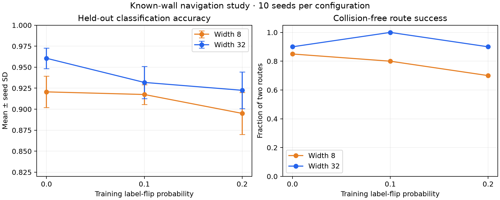

# Classifier quality and navigation on a known obstacle map

This experiment asks whether a better obstacle classifier gives a rover a safer route. The map is a vertical wall with one opening. Its obstacle labels are defined by geometry in `examples/study_navigation.py`, so we can check each rover trajectory against the true wall, including the midpoint of every movement step.

The script samples 800 balanced points per seed, makes a stratified 60/20/20 train/validation/test split, and flips only training labels at rates of 0%, 10%, or 20%. Two classifiers have hidden widths 8 and 32. Each trains for 50 epochs with the same optimizer; the checkpoint with the lowest validation negative log likelihood is evaluated once on clean test labels. Two fixed start-to-goal routes are run per model. The reference uses the true obstacle labels with the same route simulator. Ten seeds yield 60 trained models and 120 model routes.

| Width | Training noise | Test accuracy, mean ± seed SD | Collision-free route success | Mean true-wall breach samples per route |
|---:|---:|---:|---:|---:|
| 8 | 0% | 92.1% ± 1.9% | 85% | 0.00 |
| 8 | 10% | 91.7% ± 1.2% | 80% | 1.00 |
| 8 | 20% | 89.5% ± 2.5% | 70% | 3.55 |
| 32 | 0% | 96.1% ± 1.2% | 90% | 0.00 |
| 32 | 10% | 93.2% ± 1.9% | 100% | 0.00 |
| 32 | 20% | 92.2% ± 2.2% | 90% | 0.85 |

The exact-map reference reached both goals without entering the wall. The small model's mean accuracy and safe-route rate both fell as labels became noisier. Higher accuracy did not guarantee route success in an individual run: the wider model at 0% noise still failed a route in one seed. The 10% noise group had a higher observed route success rate than its 0% group for width 32, so the study does not support a strictly monotonic causal claim. Each configuration has only 20 routes; route rates are coarse and map-specific.



Run from the repository root after `pip install -e ".[app,dev]"`:

```bash
python examples/study_navigation.py --seeds 10 --epochs 50
python examples/plot_navigation_study.py
```

The raw [JSON](results/navigation_study.json) and [CSV](results/navigation_study.csv) include every run and the Python, NumPy, and operating system versions. Test points come from the same synthetic map distribution as training points; this experiment does not measure transfer to a new map. The oracle shares the rover controller and only replaces the learned hazard labels, so it is a reference for map error rather than an optimal shortest-path bound.
